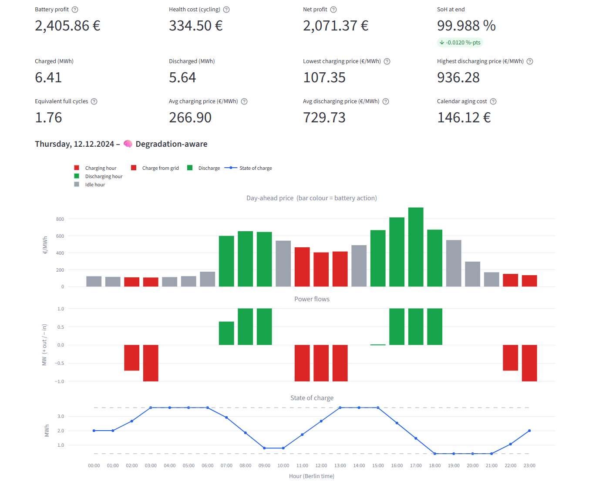
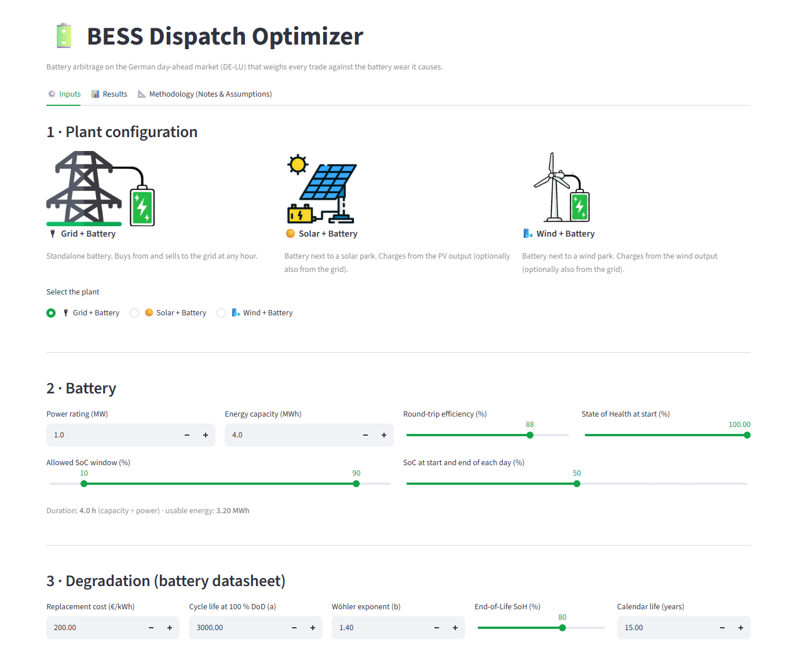
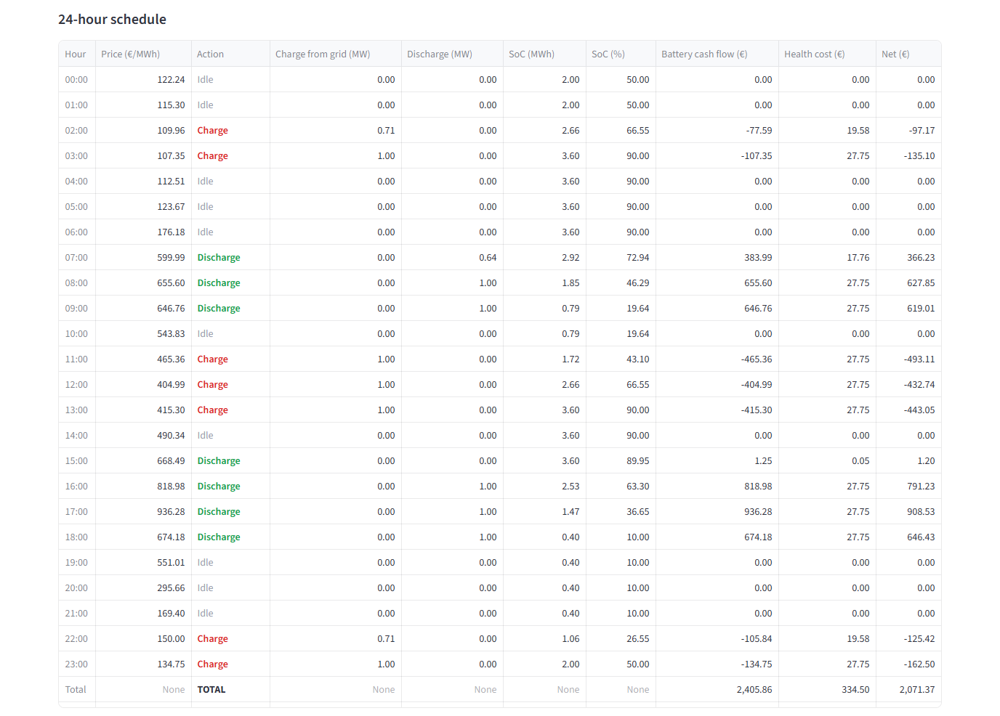
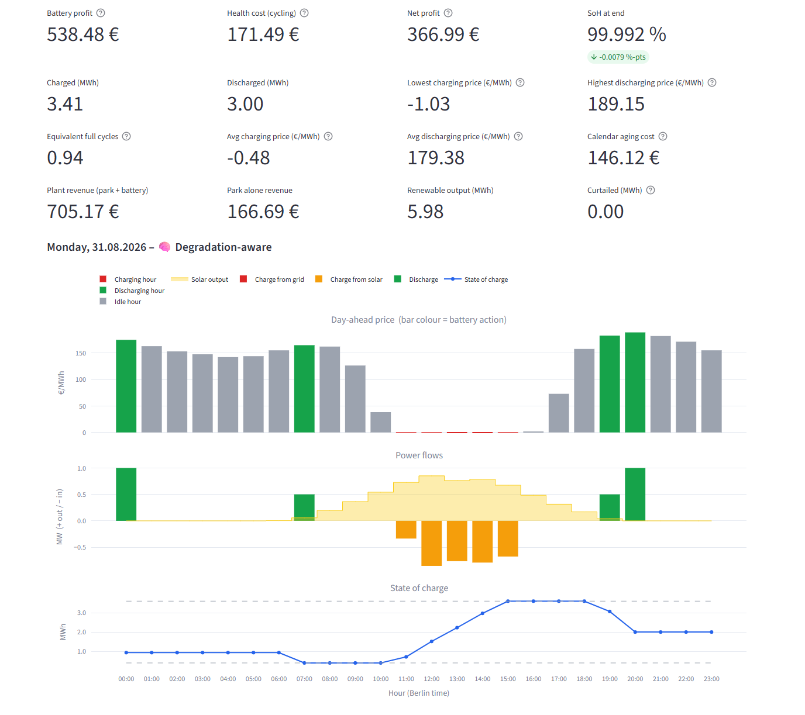
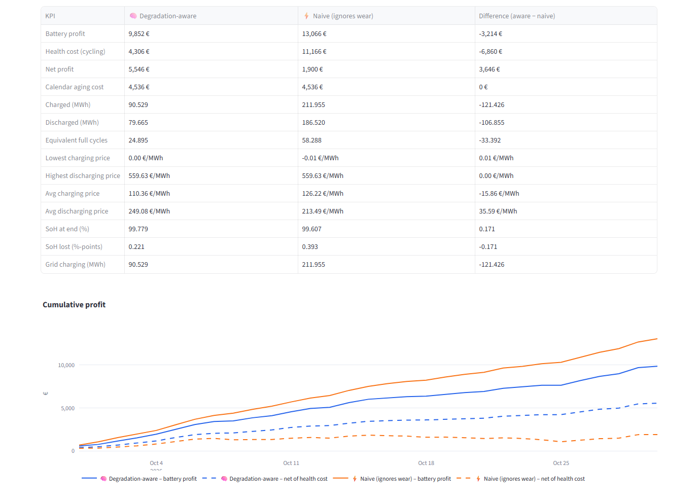
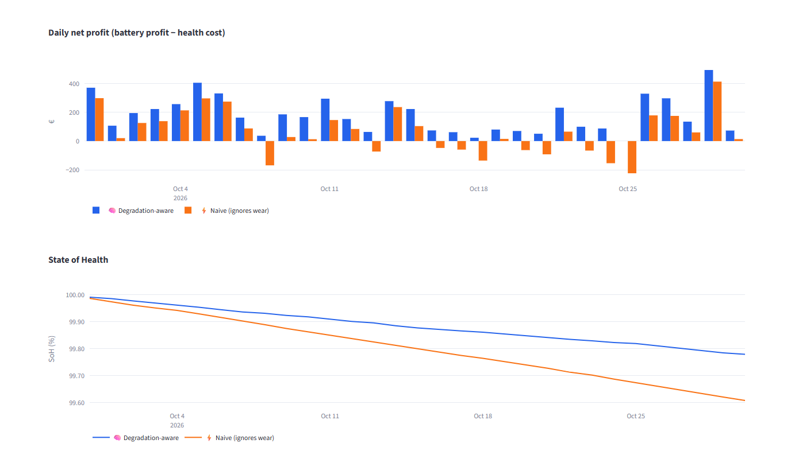
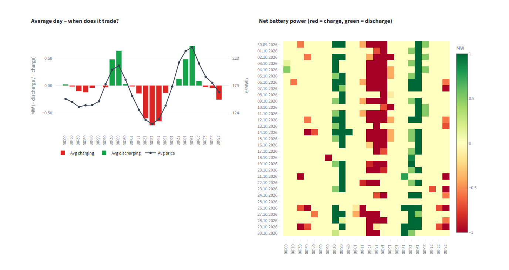

# BESS Dispatch Optimizer

A battery storage simulator for the German day-ahead power market that knows the battery wears out.

Most simple arbitrage models treat a battery as a free bucket: buy low, sell high, repeat as often as the prices allow. A real lithium-ion battery loses a bit of capacity with every cycle, and that lost capacity costs money. So a 20 €/MWh price spread can look profitable on paper and still lose money once you count the wear.

This project puts that wear cost directly into the dispatch decision. Every day the optimizer looks at the 24 hourly prices and only charges or discharges when the spread is large enough to pay for the energy losses **and** the battery degradation. It then tracks the battery's State of Health day by day over several years and compares the result with a "naive" battery that ignores wear.

It works for three setups:

- **Grid + Battery**: a standalone battery trading on the market
- **Solar + Battery**: a battery next to a PV park, which can be limited to charging only from the sun
- **Wind + Battery**: the same with a wind park

Everything is wrapped in a Streamlit app where you can change the inputs, pick any day or period, and see the schedule hour by hour.



---

## How it works

**1. Battery wear.** Cycle life depends on how deep each cycle is (Wöhler curve):

```
N_cycle(DoD) = a · DoD^(-b)        e.g. a = 3,000, b = 1.4
```

**2. Wear cost per MWh.** Battery cost divided by the energy it can move over its life:

```
Cost_deg = CAPEX / (2 · DoD_ref · N_cycle(DoD_ref))   ≈ 30.5 €/MWh, charged on every MWh in and out
```

**3. Trading threshold.** Buying 1 MWh and selling what comes back only pays off if

```
η_rt · sell_price − buy_price > Cost_deg · (1 + η_rt)     ≈ 57 €/MWh with the defaults
```

**4. Daily optimisation.** A mixed-integer linear program (PuLP + HiGHS) maximises market revenue minus the wear penalty, with the usual constraints: state-of-charge balance with losses, SoC limits, power limits, no simultaneous charging and discharging, and the battery ends the day where it started. For solar and wind the park output is split between direct sales, charging and curtailment, under a grid connection limit.

**5. State of Health.** After each day the SoC curve is split into cycles with rainflow counting, the capacity loss is added up (plus a little calendar aging), and the next day starts with a slightly smaller battery.

The app's **Methodology** tab walks through all of this with the formulas filled in from whatever inputs you choose.

---

## Screenshots

**Inputs**: plant type, battery, degradation data, prices and weather



**24-hour schedule** for one day: when to charge, when to discharge, cash flow and wear cost per hour



**Solar + Battery**: the battery fills up from the PV output around noon and sells in the evening peak



**Period comparison**: degradation-aware vs naive over a month





**When does it trade?** Average day and an hour-by-day heatmap



---

## Running it yourself

You need Python 3.12 or newer and a free ENTSO-E API token. Register on the [Transparency Platform](https://transparency.entsoe.eu/), ask for "Restful API access" by email, and then generate a token in your account settings.

```bash
git clone <this repo>
cd <repo folder>
python -m venv .venv
.venv\Scripts\activate          # Windows  (macOS/Linux: source .venv/bin/activate)
pip install -r requirements.txt
```

Put your ENTSO-E token in a file called `entsoe_api_key.txt` in the project root (just the token, nothing else). It is listed in `.gitignore`, so it won't be committed.

Download the prices once, then start the app:

```bash
python src/data_loader.py
streamlit run app.py
```

You can also download any other period (from 5 Jan 2015 onwards) straight from the app's Inputs tab, or upload your own hourly price CSV.

To reproduce the backtest table and the static charts:

```bash
python src/backtest.py        # all three setups, both models (takes ~10 minutes)
python src/analysis.py        # KPI table + charts in outputs/
python src/dispatchplots.py   # hourly timing charts and heatmaps
```

---

## Project layout

```
app.py                 Streamlit app (Inputs, Results, Methodology)
src/
  config.py            all default settings in one place
  data_loader.py       ENTSO-E download, cleaning, updates, CSV upload
  weather.py           NASA POWER weather, PV and wind power models
  degradation.py       Wöhler curve, wear cost, rainflow SoH loss
  optimizer.py         daily MILP dispatch (PuLP + HiGHS)
  backtest.py          day-by-day simulation with SoH tracking
  analysis.py          KPI table and summary charts
  dispatchplots.py     hourly timing charts and heatmaps
images_app/            pictures used in the app
docs/screenshots/      screenshots for this README
```

---

## Data sources

- **Prices**: [ENTSO-E Transparency Platform](https://transparency.entsoe.eu/), day-ahead prices for DE-LU (DE-AT-LU before October 2018), via `entsoe-py`. Since 1 Oct 2025 the market clears in 15-minute steps; these are averaged to hourly.
- **Weather**: [NASA POWER](https://power.larc.nasa.gov/) hourly solar irradiance and wind speed, free and without a key. NASA publishes sunlight data about three months late and wind about a week late. For days without measured data the app uses a typical-year estimate and says so.

---

## Assumptions and limitations

- Perfect foresight within each day: the optimizer knows the day-ahead prices when it plans. That makes the results an upper bound for what a real operator could earn.
- One constant wear cost per MWh (linearised at the reference depth of discharge). Temperature and C-rate effects are ignored, calendar aging is linear.
- Hourly resolution, day-ahead market only. No intraday, balancing or capacity revenues.
- Simple PV and wind models (flat-plate irradiance with a performance ratio, a generic turbine power curve).

## Ideas for next steps

- Day-ahead price forecasting, so the battery plans on predicted prices and gets paid the real ones
- 15-minute resolution for data after October 2025
- Piecewise-linear wear cost instead of a single constant
- Intraday and balancing markets
